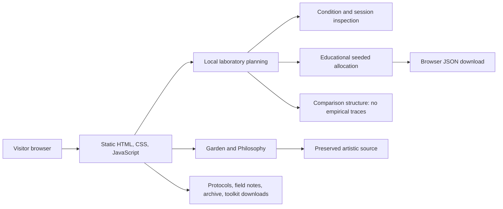
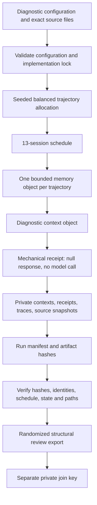
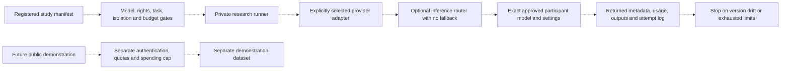
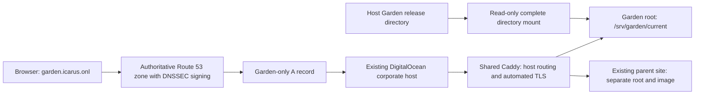
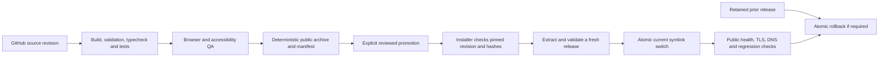

# The Garden architecture

**22 October 2026 · implementation and selected deployment design**

The Garden has two separate systems: a public static website and a local research toolkit. The website calls no model, holds no inference credentials, and collects no experimental responses. The toolkit currently runs mechanical diagnostics only. A live participant adapter is a future, explicitly reviewed component.

Source code, local checks, GitHub publication, and deployed runtime are separate evidence. The diagrams below describe the current implementation and selected hosting design; they do not certify that DNS changes, promotion, or GitHub Actions activation have completed. See the [deployment procedure](Deployment.md), [cost record](Costs.md), and final QA/operations evidence for dated verification.

## Public application

`site/` supplies seven public pages and a 404 page. The atmospheric Garden and the analytical Laboratory share navigation but have different visual treatment. The laboratory shows the factorial conditions, source availability by phase, deterministic educational allocation, configuration export, and empty paired-comparison structure. It does not execute experiments or upload historical traces.

`scripts/build.mjs` assembles `dist/` from public site source, selected documents/materials, diagnostic configurations, historical artifacts, and downloadable toolkits. The build generates a release-health document, sitemap, and per-file SHA-256 inventory. Development dependencies are pinned through the lockfile; production serves files without a Node or Python application server.

The browser's historical FNV/xorshift allocation demonstration and the toolkit's SHA-256 allocation algorithm are deliberately identified separately. Their exported records are not interchangeable. Source corpus previews are rendered as text. Public source files are not operational instructions, and future imported traces must retain the same untrusted-data boundary.

## Local research apparatus

The Python toolkit uses standard-library dependencies. Its schema accepts only the local mechanical backend and refuses live providers, tool access, silent truncation, and model fallback. A configuration lock covers the configuration, task/corpus hashes, and exact implementation files. Changing them requires a separately identified, explicitly locked diagnostic block.

Each execution has a fresh identifier; each trajectory has a separately bound memory object. Baseline memory reads/writes are disabled for all arms and memory resets before exposure. Only assigned memory-on arms retain bounded diagnostic receipts. Ambient source data appears in sessions 3–9 and is absent in sessions 1–2 and 10–13. These are data-envelope tests, not model behavior.

Artifacts preserve exact task source bytes, contexts, receipts, all scheduled records, model identity, implementation hashes, and the run inventory. Verification reconstructs assignments from the seed, checks source/configuration/lock identities, validates counts and task domains, reconstructs memory and contexts, and rejects unlisted or unexpected trace paths. Hashes detect changes and inconsistencies; they do not authenticate a bundle against an actor able to replace the complete bundle.

The reviewer export removes assignments and operational metadata and uses randomized response identifiers, with its join key outside the reviewer directory. It contains null responses and is explicitly unrateable. Human semantic blinding remains untested. See [the toolkit guide](../research/README.md), [protocol v0.4](Scientific_Protocol_v0.4.md), and [scientific review](Scientific_Review.md).

## Future inference boundary — not implemented or enabled

Dashed paths are future work. DigitalOcean's inference router or another provider may be selected only after its actual model/version metadata, reasoning/sampling settings, state behavior, API limitations, and costs are inspected. A router must not substitute a model or reasoning level. Unsupported settings must fail or be explicitly recorded as unsupported before collection; returned metadata and drift handling are part of the scientific lock.

A real memory adapter must retain the specified task/response records rather than diagnostic hashes. Source quotations may persist in those responses, so withdrawal cannot be described as erasing all treatment content. Public demonstrations, if later enabled, require abuse controls, request/input/output limits, spending caps, monitoring, and a distinct dataset. They cannot silently enter formal research data.

## Selected hosting and DNS design

The infrastructure audit selected reuse of an existing suitable DigitalOcean host instead of another App Platform application or Droplet. This introduces no new hosting resource or recurring service charge; capacity and shared-host availability remain operational considerations. Inference stays disabled.

Only the `garden.icarus.onl` address record is in scope. The existing authoritative nameservers, DNSSEC configuration, unrelated records, and mail routing are preserved. The deployment procedure must retain the pre-change DNS snapshot and verify the intended record, certificate, redirects, parent-site health, and unchanged mail records after promotion.

The selected layout mounts the complete host Garden deployment directory read-only at `/srv/garden` in the existing Caddy container. Caddy serves `/srv/garden/current`. Mounting the entire parent directory is essential: mounting only the current symlink target could prevent later atomic symlink switches from becoming visible inside the container.

Garden adds a separate host block while retaining existing Caddy global options and parent-site routes. Caddy supplies HTTPS and automated renewal, canonical HTTP redirects, security headers, compression, and caching. The complete candidate configuration must be validated with the deployed Caddy version before activation. The two original HTML prototypes are downloads because their preserved inline code is incompatible with the production site's strict content security policy. No provider secret is needed to serve static pages. Existing services and the parent site's application image retain their independent roots and deployment history.

## Build, review, and promotion

Local build/check and packaging commands are implemented. The diagram describes the intended GitHub-to-production path; repository access, Actions activation, and unattended deployment must not be marked complete without separate evidence. A successful source push does not prove that a workflow ran or that a release was promoted.

Release packaging requires a clean committed checkout and matching build/source revision. Fixed archive timestamps and stable ordering make the artifact reproducible from the same inputs. The deployment installer validates the supplied manifest checksum, archive checksum, complete revision, allowed paths/types and expansion limits, per-file inventory, and release-health identity before activation. It retains prior releases and records the previous target. Checksums require a trusted review/promotion channel; they are not a substitute for authenticated source custody.

Production promotion is explicit. Any future automated promotion must preserve the same artifact identity, least required permissions, approval requirements, rollback, and operational checks. Hosting evidence never substitutes for a completed scientific study.
